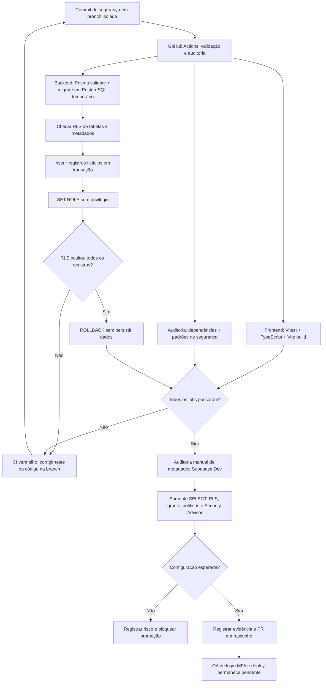

# Farol Finanças | Relatório e fluxo de testes/validações

> Data da conferência: 10/11/2026 (America/Sao_Paulo). Escopo: PR #26, branch `security/v0.20-supabase-dev-readonly-audit`,
> commit `051d53618727c657c283926c9bcd8427d4b8fd62`. Esta documentação tem branch/PR própria para revalidar o pipeline.
> **Sem deploy, sem escrita em Dev/Prod e sem testes usando contas reais.**

## 1. Fluxograma realizado

**Duas fronteiras diferentes:** o PostgreSQL temporário do CI permite **escritas fictícias** dentro de `BEGIN` + `ROLLBACK`, enquanto o **Supabase Dev real** foi examinado apenas com **SELECTs de metadados**. A produção não foi acessada para alterações.

## 2. Matriz de evidências

| Camada | Método e evidência | Resultado 10/11/2026 | Limite |
|---|---|---|---|
| Frontend | `npm ci`, Vitest, `vue-tsc` e build Vite no job `verificar` | **PASSOU** | Sem renderização real no iPhone |
| Backend | Vitest, typecheck e build no job `validar-backend` | **PASSOU** | Repositórios e tokens falsos nos testes de autenticação |
| Tokens, 2FA, autorização | Testes de sessão revogada, AAL1/AAL2, VIEWER/OWNER, usuário estranho e proteção de escrita | **PASSOU no CI** | Ainda não houve login real via Supabase Auth em duas contas artificiais |
| Banco temporário | `prisma validate`, `prisma migrate deploy`, `check-rls.ts` | **PASSOU** | PostgreSQL efêmero, não Supabase Dev |
| RLS com dados fictícios | `test-postgres-rls-isolation.ts`: cria 1 usuário, 1 workspace, membro e transação em transação; `SET ROLE` sem policy; confirma 0 linhas; `ROLLBACK` | **PASSOU** | 4 tabelas exercitadas no teste explícito, 11 verificadas quanto a RLS pelo script Prisma |
| Scan de segurança | Jobs `audit (.)` e `audit (backend)`: dependências high/critical, varredura estática e testes | **PASSOU** | Auditoria estática não substitui pentest |
| API pública | Testes do script de health/ready com rede simulada | **PASSOU** | Monitoramento externo ainda não ativo |
| Supabase Dev real | Consulta `pg_class`/`pg_namespace`/`pg_policies` e grants via SELECT | **13/13 tabelas públicas com RLS**, **0 grants diretos inesperados** | Não testou escrita real, sessão de usuário, endpoints Fastify |
| Calendário Dev | Consulta de 4 políticas para `authenticated` e filtro por `auth.uid() = user_id`; INSERT/UPDATE têm WITH CHECK | **4 políticas compatíveis** | Configuração verificada, sem E2E de dois usuários |
| Security Advisor Dev | Auditoria de avisos | **12 INFO** sem policies nas tabelas financeiras, **1 WARN** sobre senhas vazadas | Proteção contra senhas vazadas permanece desabilitada |
| Vercel/iOS | Não executado | **PENDENTE** | Exige publicação e testes manuais/E2E |

## 3. Como a regressão foi executada

1. Branch `security/v0.20-supabase-dev-readonly-audit` foi criada a partir de `security/v0.19-automated-security-regression`. Testes novos foram mantidos em PR rascunho.
2. GitHub Actions instalou dependências fixadas pelos lockfiles. O frontend executou testes de domínio, script de monitor simulado, TypeScript e build.
3. GitHub Actions criou serviço **PostgreSQL 16 temporário** em `localhost:5433/farol` e rodou as migrações Prisma. O script `check-rls.ts` confirmou RLS nas 11 tabelas principais e controle de exposição dos metadados internos de migração nesse banco efêmero.
4. O teste RLS abriu `BEGIN`, criou um papel fictício com apenas SELECT, inseriu um espaço e registros artificiais, trocou de papel, confirmou que 4 tabelas ocultavam seus registros, e sempre executou `ROLLBACK`.
5. O primeiro ciclo de CI falhou porque o teste SQL não forneceu o campo `Transaction.id`, que é gerado no Prisma e não possuía default SQL no modelo testado. **O problema era no dado fictício do teste**, não uma migração em Dev. O script foi corrigido e rodou novamente.
6. A execução final passou nos jobs frontend, backend e auditorias de segurança.
7. Foi realizada uma **conferência adicional e atual de metadados reais** no Supabase Dev, por meio de consultas SELECT, sem abrir informações pessoais nem modificar registros.
8. As evidências e as pendências foram documentadas. PRs permanecem rascunho, sem merge/publicação.

## 4. Conferência de metadados do Supabase Dev em 10/11/2026

- Projeto: `Farol Finanças Dev`, referência `tvirkrjkgdtybtcundon`, estado `ACTIVE_HEALTHY` na consulta.
- Total de tabelas públicas analisadas: **13**; com RLS habilitada: **13**; sem RLS: **0**.
- Grants diretos inesperados de SELECT, INSERT, UPDATE ou DELETE a `anon` e `authenticated` fora do calendário: **0**.
- `calendar_events` expõe apenas as quatro políticas por comando para usuários autenticados, com filtro de titular; INSERT/UPDATE têm WITH CHECK.
- `_prisma_migrations` **não estava presente** entre as tabelas públicas retornadas no Supabase Dev nessa verificação. Isso não autoriza presumir estado semelhante em outros ambientes.
- O Security Advisor listou 12 informações sobre RLS sem políticas nas tabelas financeiras/documentais. Como o acesso direto é negado, isso é compatível com arquitetura de acesso via API confiável, mas requer confirmação da autorização na API real.
- Existe **1 aviso**: leaked password protection desligada. Consultar: https://supabase.com/docs/guides/auth/password-security#password-strength-and-leaked-password-protection

**Verificação parcial de privacidade, não um certificado de invulnerabilidade.** No Dev não foram criadas contas artificiais para testar login real, revogação de sessão ou vazamento lateral. Essas provas dependem de E2E com duas contas de QA e um backend Dev isolado.

## 5. Evidências GitHub e reprodução

- [PR #26: auditoria somente leitura e teste RLS](https://github.com/GutoSwan/farol-financas/pull/26)
- [Validação GitHub Actions: sucesso após correção](https://github.com/GutoSwan/farol-financas/actions/runs/42808758479)
- [Auditoria GitHub Actions: sucesso](https://github.com/GutoSwan/farol-financas/actions/runs/42808758510)
- Para repetir em nova alteração: enviar commit a uma branch `security/**` ou abrir uma PR elegível; acompanhar os jobs `verificar`, `validar-backend`, `audit (.)` e `audit (backend)`.
- Caso o job fique vermelho: consultar o passo exato, corrigir em branch isolada e aguardar novo CI verde antes de promover código.
- Os horários `schedule` de monitoramento e a checagem periódica do Supabase Dev **não estão ativos** enquanto os workflows não estiverem na branch padrão e os opt-ins/segredos isolados não forem configurados.

## 6. Critérios de liberação e pendências

**Para liberar uma implantação:** CI verde no commit final, PR revisada, ambiente Vercel validado, URL e variáveis certas, testes de login/2FA com contas artificiais, provas de isolamento real, plano de rollback, verificação de que não há credenciais no frontend e QA no iPhone/PWA.

**Ainda pendente:** testes E2E de cadastro/login, QR/TOTP, recuperação de conta, separação de dois usuários reais de QA no Dev, monitor público ativo, revisão de senhas vazadas, revisão de migração financeira em transação e aprovação explícita de mudanças de banco. **Nenhum desses itens foi falsamente marcado como concluído.**
