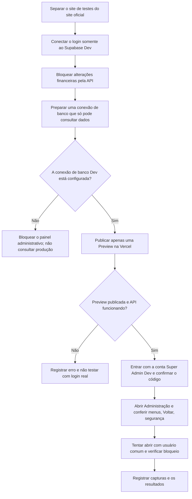

# Farol Finanças | Preview isolada do Super Admin

**Data:** 10/11/2026  
**Escopo:** Vercel Preview + Supabase **Dev** `tvirkrjkgdtybtcundon`. Nunca produção.  
**Situação:** *preparação e testes de bloqueio realizados; teste real do painel pendente*.

## Objetivo explicado de forma simples

Abrir uma versão de testes do Farol para experimentar o painel de Administração com o e-mail do responsável, sem correr o risco de alterar os dados financeiros verdadeiros.

## Fluxograma



## O que foi configurado nesta branch

- **Frontend:** `VITE_SUPABASE_URL` e `VITE_SUPABASE_PUBLISHABLE_KEY` são do **Dev**; `VITE_FAROL_QA_DEV_ONLY=true` impede iniciar o cliente Auth se a URL apontar para produção; `VITE_ENABLE_ONLINE_WORKSPACE_WRITES=false`.
- **Backend:** `SUPABASE_URL` e `FAROL_DEV_SUPABASE_REF` identificam o Dev; `FAROL_PREVIEW_ADMIN_QA_READONLY=true`; gravação de espaços e faturas desativada. A API bloqueia todas as operações POST, PATCH, PUT e DELETE em `/api/v1/`.
- **Banco de dados:** a aplicação exige conexão com uma role Postgres **somente de leitura**, chamada `farol_preview_adminqa_ro`, hospedada no mesmo Dev e acessada pelo pooler PostgreSQL com TLS e certificado verificado. **Essa credencial ainda não foi criada nem configurada na Vercel.**
- **CORS:** bloqueado provisoriamente com origem inexistente. A origem precisa ser atualizada para a URL HTTPS exata da nova Preview antes dos testes reais.

## Bloqueios encontrados

1. O cadastro automático de uma role de banco de dados temporária foi **impedido pelo controle de segurança da ferramenta**. Nenhuma role nem senha foi criada. O projeto Supabase Dev não sofreu alteração nesta tentativa.
2. A credencial de Dev existente em outra branch é do tipo **sensitive** na Vercel, por isso não é possível recuperá-la e copiá-la. Não copiar a variável de produção.
3. A Vercel recusou a criação de um novo deployment com **HTTP 402 / `api-deployments-free-per-day`**, por ter alcançado o limite diário. Uma Preview READY de commit anterior **não prova** que o código atual esteja publicado.

## Etapa manual para configurar a conexão mínima de leitura, quando puder continuar

**Nunca envie senhas ou tokens ao chat ou ao GitHub.** Faça essa preparação **somente no projeto Supabase Dev**.

No Supabase Dev, crie uma role Postgres de login chamada `farol_preview_adminqa_ro`, com uma senha forte aleatória armazenada no seu gerenciador de senhas. Se estiver usando o editor SQL, o bloco abaixo mostra as permissões mínimas a aplicar **depois de criar a role pelo painel/cliente Postgres**:

```sql
ALTER ROLE farol_preview_adminqa_ro SET default_transaction_read_only = 'on';
ALTER ROLE farol_preview_adminqa_ro SET statement_timeout = '7000';
GRANT CONNECT ON DATABASE postgres TO farol_preview_adminqa_ro;
GRANT USAGE ON SCHEMA auth TO farol_preview_adminqa_ro;

GRANT SELECT (id, user_id, not_after)
ON auth.sessions TO farol_preview_adminqa_ro;

GRANT SELECT (
  id, email_confirmed_at, deleted_at, banned_until,
  is_anonymous, raw_app_meta_data
)
ON auth.users TO farol_preview_adminqa_ro;

GRANT SELECT (id, user_id, factor_type, status)
ON auth.mfa_factors TO farol_preview_adminqa_ro;
```

No projeto Vercel **farol-api**, em **Settings > Environment Variables**, adicione `DATABASE_URL` como **Sensitive**, com destino **Preview**, limitada **exclusivamente** à branch `security/v0.26-isolated-superadmin-preview`. Use a URL de transação do **pooler real exibido em Connect no Supabase Dev**, porta **6543** e usuário `farol_preview_adminqa_ro.tvirkrjkgdtybtcundon`. Não usar um endereço do pooler suposto por região nem copiar a credencial de produção.

Depois disso, configure `CORS_ORIGIN` no mesmo escopo com a URL **exata** do frontend Preview publicado. **Não** altere o CORS global de produção.

Com a cota de deployments restabelecida, execute uma nova **Preview**, confira `/api/v1/ready`, confirme que login e API apontam ao mesmo Dev e somente então faça login real no painel. Ao encerrar, revogue/remova o acesso de banco temporário.

## Testes possíveis sem credencial real

- Os testes automatizados verificam que o frontend recusa a URL de produção quando em modo QA Dev-only.
- Os testes da API rejeitam uma URL de banco da produção, usuário Postgres com privilégios elevados, senha inválida, escrita habilitada e pooler inesperado.
- A operação administrativa continua protegida por token válido, sessão ativa, AAL2, e-mail confirmado, TOTP verificado e papel Super Admin consultado no banco.
- A Preview permanece **fechada para acesso administrativo** se houver erro ou ausência de variável.

**Não realizado:** teste positivo de acesso à Administração pela conta real na Vercel. A cota de publicação e a conexão de banco precisam estar regularizadas. Todos os testes previamente feitos com conta real no Supabase Dev referem-se a Auth e permissões no banco, não à interface da Preview.
