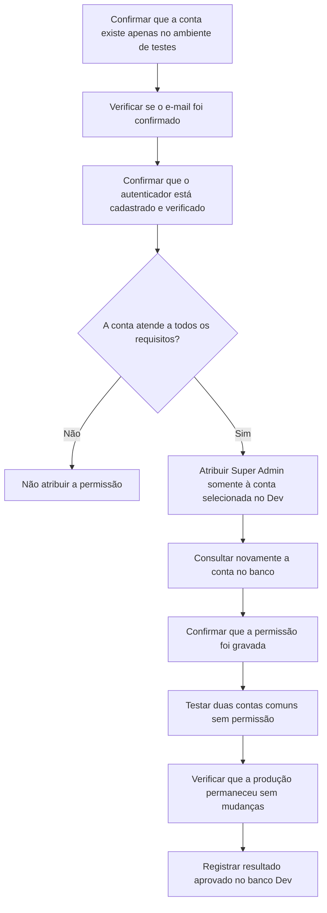

# Farol Finanças | Ativação Super Admin no ambiente de testes

**Data:** 10/11/2026  
**Ambiente:** Supabase Farol Finanças **Dev**, não produção  
**Objetivo:** permitir que a conta do responsável pelo Farol acesse, futuramente, o painel técnico mediante e-mail confirmado, autenticador e permissão especial.

## Resultado

**A conta indicada foi ativada como Super Admin no Supabase Dev.** A alteração foi limitada ao campo de papel administrativo de sua própria conta, preservando os metadados existentes de autenticação e os acessos das demais pessoas.

| Verificação | Resultado confirmado |
|---|---|
| Conta do responsável existe no Supabase Dev | Sim, uma única conta |
| E-mail confirmado | Sim |
| Autenticador TOTP verificado | Sim, um |
| Sessão com 2FA registrada | Sim, uma sessão AAL2 foi localizada |
| Papel administrativo `super_admin` atribuído | Sim, apenas no Dev |
| Metadados originais do provedor de login preservados | Sim |
| Outras duas contas de QA receberam papel administrativo | Não |
| Contas Super Admin na produção após os testes | Nenhuma |

## Fluxograma fácil de entender

## O que significa ser Super Admin?

O Super Admin poderá acessar a área técnica do Farol, incluindo os atalhos preparados para backup e dados na nuvem. **Isso não libera o acesso automático a lançamentos ou dados financeiros pertencentes a outras pessoas.** Cada espaço financeiro continua exigindo suas permissões específicas.

O servidor verifica **em cada tentativa** se a sessão está autenticada, possui 2FA e se a conta continua com a permissão Super Admin. O e-mail e o papel não podem ser simplesmente editados no navegador para liberar acesso.

## O que foi testado nesta ativação?

1. **Preparação:** localizamos exatamente uma conta no Dev, com e-mail confirmado, 2FA verificado e registro de autenticação AAL2.
2. **Alteração controlada:** atualizamos apenas o papel de acesso da conta, usando os dados já registrados no Auth do projeto Dev. Outros metadados foram preservados.
3. **Conferência de resultado:** a conta passou a satisfazer todos os critérios atuais de autorização do servidor.
4. **Tentativa com contas comuns:** duas contas de teste com 2FA continuaram sem autorização administrativa.
5. **Controle de produção:** uma consulta somente leitura confirmou que nenhuma conta da produção recebeu o papel Super Admin.
6. **Regressões no código:** a API tem testes automatizados para bloquear sessões sem 2FA, papel ausente, usuário comum, token inválido e falhas de consulta.

## Próximo teste que ainda falta

A **abertura real do painel no navegador**, usando a sessão da conta que foi promovida, ainda precisa de uma **Preview da Vercel com frontend e backend conectados exclusivamente ao Supabase Dev**. Até essa Preview ser validada, **não acessar a área administrativa por uma URL que possa usar a produção**.

Ao abrir a Preview correta, sair e entrar novamente na conta para renovar os dados de autenticação que aparecem na interface. Fazer login normal e confirmar o TOTP. Testar `/administracao`, `/seguranca`, `/backup-local`, botão Voltar e comportamento no celular. Em seguida, testar uma conta comum e conferir acesso negado.

**Conclusão:** atribuição e verificações no banco **aprovadas no Supabase Dev**; teste visual autenticado com backend Dev **pendente**. Nenhum segredo, senha, token ou código do autenticador foi requisitado.
