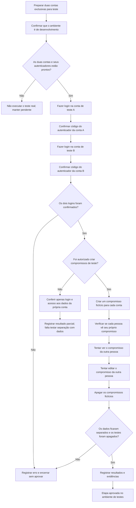

# Farol Finanças | Teste de login e privacidade com duas contas

**Explicação simples para documentação de QA**

Data da preparação: **10/11/2026**. Este teste é destinado **somente ao Supabase Dev**, nunca à produção.

## O que queremos descobrir?

Imagine duas pessoas usando o Farol. Cada uma tem sua própria conta. Queremos verificar que:

- Cada pessoa só entra usando sua própria senha e o código do aplicativo autenticador.
- Um usuário não consegue ver compromissos particulares de outro.
- Um usuário não consegue alterar compromissos particulares de outro.
- Tudo que foi criado apenas para o teste é apagado ao final.
- Se alguma proteção falhar, o teste mostra erro e **não considera o resultado aprovado**.

## Fluxograma fácil de entender

## O que significa cada etapa?

| Etapa | O que fazemos | Por que isso importa |
|---|---|---|
| Preparação | Configuramos duas contas criadas **apenas para QA**, com endereços contendo `+farolqa` | Evita usar contas pessoais ou alterar dados existentes |
| Conferência do ambiente | O script aceita apenas o projeto `Farol Finanças Dev` e chave pública de acesso | Evita que o teste toque no projeto de produção |
| Login A | Entramos com a senha da primeira conta de teste | Confere que o servidor reconhece aquela conta |
| Segundo fator A | Informamos um código válido gerado pelo autenticador exclusivo da conta A | Confere que senha sozinha não basta para concluir a autenticação protegida |
| Login e segundo fator B | Repetimos o processo com a segunda conta, que usa outro autenticador | Garante que são duas identidades independentes |
| Verificação sem gravação | Consultamos os compromissos e conferimos que pertencem ao usuário autenticado | Encontra possíveis vazamentos em uma leitura comum |
| Compromissos fictícios | Se o responsável autorizar, cada conta cria um evento marcado `FAROL-QA-TEST` | Permite provar a separação com dados de verdade |
| Tentativa de acesso cruzado | Pedimos que a conta B veja e edite o compromisso da A, e vice-versa para leitura | O sistema precisa negar o acesso, mesmo com os IDs conhecidos |
| Limpeza | O script tenta apagar **somente os eventos que ele gerou**, conferindo se sumiram | Evita deixar lixo de teste no calendário |
| Resultado | Se houver falha, a execução termina com erro e precisa ser investigada | Impede que um problema passe despercebido |

## O que já foi validado?

Os testes anteriores do Farol no GitHub passaram: verificações simuladas de login e permissões, banco PostgreSQL temporário, RLS, build e segurança. A conferência de metadados reais do Supabase Dev também comprovou RLS habilitada nas 13 tabelas públicas e políticas de propriedade no calendário.

**Nesta etapa** foi preparado um roteiro executável que realiza login no **Supabase Dev real** com duas contas de QA e seus respectivos códigos TOTP, além de testar o calendário com compromissos fictícios e limpeza automática. Testes locais de segurança do roteiro são executados pelo GitHub Actions a cada mudança. **O roteiro real ainda não foi disparado**: não temos duas contas exclusivas de QA prontas com suas credenciais configuradas no ambiente protegido. Nenhuma conta nova foi criada automaticamente.

## Como executar o teste real com segurança

1. Criar **duas contas novas de QA no Supabase Dev**, com e-mails confirmados, cada uma com um endereço contendo `+farolqa`, senhas fortes distintas e um autenticador TOTP verificado. Não usar contas pessoais ou existentes.
2. No repositório do GitHub, acessar `Settings > Environments` e criar o ambiente **`farol-supabase-qa-dev`**, com aprovação manual recomendada.
3. Adicionar **somente nesse ambiente** os segredos `FAROL_QA_PUBLISHABLE_KEY`, `FAROL_QA_A_EMAIL`, `FAROL_QA_A_PASSWORD`, `FAROL_QA_A_TOTP_SECRET`, `FAROL_QA_B_EMAIL`, `FAROL_QA_B_PASSWORD`, `FAROL_QA_B_TOTP_SECRET`. Nunca colar senhas ou segredos TOTP no chat ou no código.
4. Em `Settings > Secrets and variables > Actions > Variables`, configurar `FAROL_QA_E2E_ENABLED=true` somente após aprovação do ambiente e criação das contas. Não habilitar este teste em Supabase de produção.
5. **Depois que o workflow for integrado à branch padrão**, acessar `Actions > QA real de login, 2FA e isolamento - Supabase Dev > Run workflow`.
6. Marcar a confirmação de que as duas contas são exclusivas de QA. Na primeira execução, deixar desmarcada a opção de criar compromissos. Isso valida login/2FA sem modificar o calendário.
7. Se as contas funcionarem, executar outra vez marcando a criação de compromissos fictícios. O teste cria dois eventos de QA, confere bloqueios de leitura/edição e depois remove os próprios eventos.
8. Conferir o resultado: **verde = testes executados e aprovados**, **vermelho = falha**, **ignorado = teste não executou**. Se a limpeza falhar, revisar somente os eventos `FAROL-QA-TEST` das contas de QA.

## Limites importantes

- O teste não confirma funcionamento visual de QR Code, PWA ou iPhone. Isso exigirá teste no próprio aparelho.
- A autenticação por e-mail, a tela de recuperação de senha e a criação de contas ainda exigem cenários específicos. Este roteiro testa **login de contas previamente preparadas**.
- O calendário é um serviço direto do Supabase. Para testar todos os recursos financeiros e seus espaços, será necessário publicar uma **API Dev isolada** e validar seu JWT contra duas contas de QA.
- O modo sem compromissos fictícios é **parcial**, pois um calendário vazio não demonstra que uma conta está isolada de outra.
- Os testes com eventos fictícios são limitados aos identificadores criados na própria execução; qualquer interrupção pode deixar algum evento pendente de limpeza, razão pela qual os logs notificam esse risco.
- **Não foi executado nenhum login real de QA nesta etapa até a existência de credenciais autorizadas e seguras.** Não interpretar o sucesso dos testes de preparação como sucesso do E2E ao vivo.

## Evidência

- Código: `scripts/qa-real-auth-e2e.mjs`
- Proteções e testes de preparação: `scripts/qa-real-auth-guards.mjs` e `scripts/qa-real-auth-guards.test.mjs`
- Execução manual protegida: `.github/workflows/qa-real-auth-e2e.yml`
- Validação de CI: `.github/workflows/validate.yml` (testa as proteções sem acessar o Dev)
