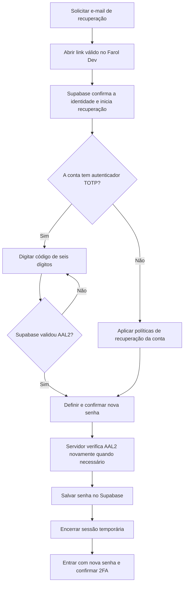

# Farol Finanças | Correção de recuperação com autenticador AAL2

**Data:** 10/11/2026  
**Escopo:** somente branch de QA da Preview Dev `security/v0.27-auth-only-admin-preview`.  
**Relato recebido:** `AAL2 session is required to update email or password when MFA is enabled.`

## Qual era o problema?

O link de recuperação por e-mail cria uma sessão de recuperação que normalmente está no nível **AAL1**. A conta de testes já possui um autenticador TOTP válido, então o Supabase exige que a pessoa prove também o segundo fator, elevando a sessão a **AAL2**, antes de permitir alterar a senha.

A tela anterior aceitava digitar uma nova senha depois de clicar no link, mas não apresentava o desafio do autenticador. Assim, a API do Supabase rejeitava o pedido corretamente.

## O que foi corrigido

1. O usuário abre o link de recuperação e o Farol reconhece o evento `PASSWORD_RECOVERY`, ou valida o link colado diretamente na página.
2. O Farol consulta a identidade atual, a sessão e os fatores TOTP **verificados no Supabase Dev**, sem confiar em um campo local.
3. Se houver TOTP cadastrado e a sessão ainda estiver em **AAL1**, a tela oferece o campo **Código de seis dígitos do aplicativo autenticador**.
4. O código é validado diretamente no Supabase com `mfa.challenge` e `mfa.verify` (utilitário `verifyTotpCode`).
5. Depois de validar, o Farol exige confirmação `currentLevel === 'aal2'`.
6. Só então aparece o formulário **Definir nova senha**. Antes de salvar, o aplicativo confere **novamente** identidade, fator verificado e AAL2 no Supabase.
7. A sessão temporária é encerrada depois da troca de senha. O usuário entra de novo com a nova senha e autentica novamente o TOTP.

Nenhum autenticador é removido, nenhum código precisa ser enviado para o suporte e nenhuma senha é alterada por um administrador.

## Fluxograma simples

**Importante:** se a conta tiver papel `super_admin` e não tiver nenhum TOTP verificado, a recuperação não concede permissão para alterar senha nem para entrar no painel. Esse caso exige recuperação administrativa com prova de identidade e nunca desativa automaticamente o segundo fator.

## Evidências

- `src/presentation/composables/useAuth.ts`: `prepareRecoveryMfa`, `verifyRecoveryMfa` e `updatePassword` com verificação remota `aal2`.
- `src/presentation/pages/AuthPage.vue`: código TOTP antes da nova senha.
- `tests/passwordRecoveryMfa.test.ts`: regressões de AAL2 obrigatório, TOTP vinculado, botão protegido, sessão encerrada.
- `tests/passwordRecoveryFlow.test.ts`: regressão da ordem das telas.
- Testes GitHub Actions associados ao último commit da branch.

## Como testar após a nova Preview ser publicada

- Usar **um novo e-mail** de recuperação no Supabase Dev. Links antigos podem estar expirados ou consumidos.
- Abrir o link e confirmar que aparece **Confirmar autenticador** antes da tela da nova senha.
- Informar o código apenas dentro da Preview HTTPS do Farol Dev. Não compartilhar código, QR, senha ou link no chat.
- Tentar senha nova antes de confirmar o 2FA deve ser bloqueado.
- Depois do código válido, definir nova senha. Entrar de novo e confirmar TOTP; o painel Admin deverá ser verificado à parte.
- Contas comuns continuam sem acesso ao painel `/administracao`.

**Ambiente de produção inalterado.** Este documento não representa prova de alteração bem-sucedida da senha da conta real: o titular precisa realizar o teste de recuperação pelo navegador.
