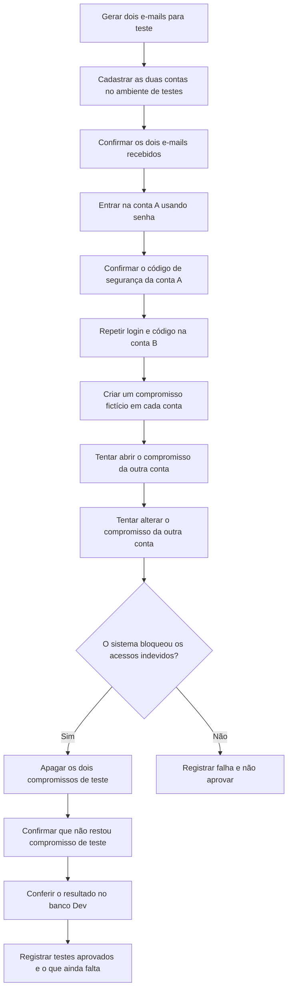

# Farol Finanças | Teste real com duas contas fictícias

**Data:** 10/11/2026  
**Ambiente:** Supabase **Farol Finanças Dev** (não é produção)  
**Tipo:** cadastro, confirmação do e-mail, login, verificação em duas etapas e isolamento do calendário  
**Situação:** **APROVADO nos cenários executados**

> Esta documentação foi escrita em linguagem simples para servir como base de um relatório próprio de QA.

## 1. Por que fizemos este teste?

Queremos garantir que duas pessoas diferentes consigam entrar com segurança no Farol e que **uma pessoa não consiga abrir ou alterar informações particulares da outra**.

Para isso, foram usadas duas contas **criadas exclusivamente para teste**. Os endereços de e-mail foram gerados aleatoriamente e não pertencem a usuários reais.

## 2. Fluxograma simples do que foi feito

## 3. Resultado de cada verificação

| Etapa | O que foi verificado | Resultado |
|---|---|---|
| Gerador de e-mail | Foram gerados dois endereços aleatórios de QA com serviço GrabMail | **PASSOU** |
| Cadastro | Cada endereço criou um usuário novo no Supabase Dev | **PASSOU** |
| Confirmação do e-mail | A mensagem de confirmação chegou e foi validada nos dois casos | **PASSOU** |
| Login com senha | Cada pessoa de teste conseguiu entrar somente com as credenciais respectivas | **PASSOU** |
| Segurança em duas etapas | Cada conta registrou seu próprio autenticador e confirmou um código TOTP | **PASSOU** |
| Nível de segurança | Depois do código, cada conta obteve uma sessão com proteção `aal2` | **PASSOU** |
| Consulta de compromissos | Cada conta conseguiu consultar seus compromissos sem receber dados da outra | **PASSOU** |
| Criar dados de teste | Cada conta criou um compromisso fictício, sem usar dados financeiros reais | **PASSOU** |
| Privacidade entre contas | Uma conta não conseguiu visualizar o compromisso da outra | **PASSOU** |
| Bloqueio de edição | A tentativa de editar o compromisso alheio não teve acesso autorizado | **PASSOU** |
| Limpeza | Os dois compromissos fictícios foram apagados | **PASSOU** |
| Conferência independente | Consulta `SELECT` ao Supabase Dev mostrou 0 compromissos restantes para cada conta | **PASSOU** |

### Conferência feita no banco, separada dos logs do teste

| Conta | E-mail confirmado | Autenticador 2FA verificado | Sessões com 2FA | Compromissos restantes |
|---|---|---|---|---|
| QA A | Sim | 1 | 1 | 0 |
| QA B | Sim | 1 | 1 | 0 |

Essa conferência acessou **somente os registros necessários para validar as duas contas de QA**, sem alterar usuários existentes ou tabelas financeiras.

## 4. Como o processo foi executado

1. Foi criado um roteiro que só aceita o endereço exato do Supabase Dev e uma chave **pública** de autenticação. Ele não usa chave de administrador.
2. Os dois primeiros serviços consultados não disponibilizaram caixas de entrada para uso. O teste interrompeu corretamente nessas tentativas, sem criar contas.
3. Na terceira tentativa, o serviço **GrabMail** disponibilizou dois endereços de e-mail aleatórios. Foi realizado o cadastro usando o fluxo normal de autenticação do Supabase.
4. As duas mensagens de confirmação foram recebidas; as contas foram confirmadas.
5. Cada conta fez login com sua senha e, depois, habilitou e verificou um aplicativo autenticador. O Supabase registrou o nível `aal2` para as duas sessões.
6. Cada conta criou um evento marcado `FAROL-QA-TEST` em seu calendário.
7. O teste tentou visualizar e editar o evento de uma conta usando a sessão da outra. A consulta não retornou o evento alheio, e a tentativa de edição não foi autorizada.
8. O roteiro apagou os dois eventos de teste, conferiu a limpeza e eliminou as mensagens temporárias do serviço de e-mail.
9. Uma segunda consulta, diretamente no banco do Supabase Dev, verificou **dois autenticadores confirmados, duas sessões `aal2` e nenhum evento restante** nas contas de QA.
10. O código usado apenas para disparar esta criação única foi retirado da rotina de validação do GitHub. **Não haverá novos cadastros automáticos por esse gatilho.**

## 5. O que ainda não foi testado

- A tela visual de QR Code e o fluxo dentro do aplicativo Farol.
- A recuperação de conta por e-mail ou telefone.
- Uma tentativa de acessar lançamentos financeiros por meio da **API Dev publicada**. Os testes reais desta etapa ocorreram em **Supabase Auth e calendário**, não nas telas da Vercel.
- O funcionamento do aplicativo no iPhone/PWA e suas notificações.
- A exclusão administrativa dos dois usuários do Supabase Auth.

Portanto, **não declarar o Farol inteiro como aprovado**. O resultado positivo é limitado aos cenários acima.

## 6. Contas criadas e limpeza pendente

Duas contas fictícias foram criadas no projeto Dev. Seus identificadores, úteis para eventual exclusão administrativa, são:

- QA A: `67a9b781-2165-4b27-a6ec-b536265214c7`
- QA B: `786fc2bd-47c8-4f2b-a23a-e5caf2341c8b`

Os endereços eram aleatórios e as senhas e segredos de 2FA foram mantidos apenas na memória do processo de teste. **Não foram salvos no repositório.** As caixas públicas temporárias já tiveram suas mensagens removidas.

**Atenção:** os dois usuários de Auth **continuam no Supabase Dev**. Recomenda-se excluí-los com os controles administrativos de **Authentication > Users** ou com `auth.admin.deleteUser()` em servidor confiável após encerrar o QA. Não fazer DELETE direto em tabelas de autenticação sem revisão. Como os endereços eram descartáveis, **não utilizar essas contas para dados reais**.

## 7. Evidências

- [Execução real com contas descartáveis, 2FA, isolamento e limpeza: GitHub Actions](https://github.com/GutoSwan/farol-financas/actions/runs/42814333030)
- [Auditoria de segurança do mesmo commit](https://github.com/GutoSwan/farol-financas/actions/runs/42814332957)
- `scripts/qa-disposable-live-e2e.mjs`: roteiro reproduzível, com exigência de ativação explícita e bloqueio de produção.
- [Serviço de e-mail temporário usado: GrabMail](https://grabmail.io/docs/api)

**Resultado principal:** testes de cadastro, e-mail, senha, 2FA, separação de compromissos e limpeza **APROVADOS** no Supabase Dev em 10/11/2026.
