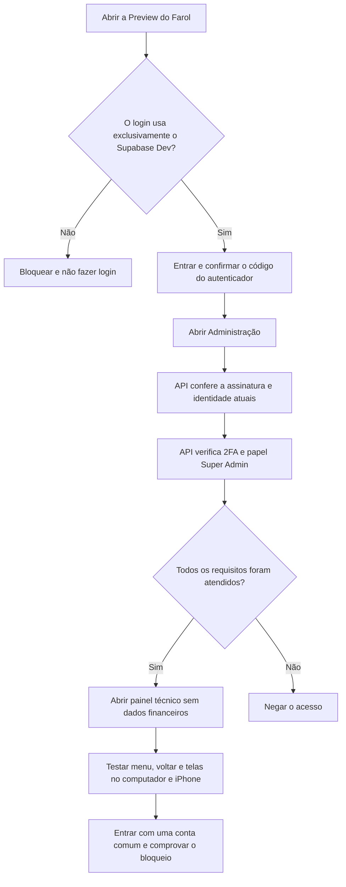

# Farol Finanças | Próxima etapa: Super Admin Dev em Preview sem banco

**Data:** 10/11/2026  
**Projeto:** Supabase Dev `tvirkrjkgdtybtcundon`  
**Branch:** `security/v0.27-auth-only-admin-preview`  
**Status:** modo de teste desenvolvido, variáveis específicas de branch configuradas, **sem deployment da versão nova** porque a Vercel atingiu a cota.

## O que mudou

Para testar somente a autorização da área Super Admin, **não é necessário conectar PostgreSQL**.

Foi criado um modo de QA **somente para Vercel Preview e somente para o Supabase Dev**. Ele valida:

1. Assinatura do token e validade no JWKS oficial do Supabase Dev.
2. Identidade atual por `GET /auth/v1/user`, com o token de quem está fazendo o teste.
3. Confirmação do e-mail e nível `aal2` no token.
4. Papel `super_admin` na resposta atual do Supabase Auth (não em `user_metadata`).
5. Existência atual de um fator TOTP confirmado via `GET /auth/v1/user/factors`.

**Nenhuma senha de banco, service_role, token ou segredo de autenticador é enviado ao navegador pelo backend.** A chave `sb_publishable_...` é pública, limitada ao cliente Auth. O backend não executa nenhuma consulta de dados financeiros nesse modo.

O endpoint permitido no QA é `GET /api/v1/admin/access` (além de `health` e `ready`). Todo o restante da API é negado com HTTP 403, incluindo consultas e alterações financeiras.

**Limitação de segurança:** essa validação usa o endpoint Auth do Supabase, não a verificação direta de `auth.sessions` por SQL. Não garante revogação imediata de sessões em todos os cenários. Este modo é apenas para testes de interface e permissão, **não deve ser habilitado em produção**.

## Fluxograma

## Configuração já salva na Vercel

**Projeto frontend `farol-financas`:** apenas a branch `security/v0.27-auth-only-admin-preview`:
- `VITE_SUPABASE_URL` -> endereço público exato do **Dev**.
- `VITE_SUPABASE_PUBLISHABLE_KEY` -> chave pública do **Dev**.
- `VITE_FAROL_QA_DEV_ONLY=true`.
- `VITE_ENABLE_ONLINE_WORKSPACE_WRITES=false`.
- `VITE_API_BASE_URL` -> endereço propositalmente inválido até o backend estar publicado e confirmado.

**Projeto API `farol-api`:** apenas a mesma branch:
- `SUPABASE_URL`, `SUPABASE_PUBLISHABLE_KEY` e `FAROL_DEV_SUPABASE_REF` -> **Dev**.
- `FAROL_PREVIEW_ADMIN_QA_AUTH_ONLY=true`, `FAROL_PREVIEW_ADMIN_QA_READONLY=true`.
- `FAROL_FINANCIAL_WRITES_ENABLED=false`, `FAROL_INVOICE_UPLOADS_ENABLED=false`, `FAROL_INVOICE_READS_ENABLED=false`.
- `DATABASE_URL` -> **endereço inválido de bloqueio**, nunca um banco de produção ou Dev. O modo Auth-only não usa essa variável.
- `CORS_ORIGIN` -> origem inexistente e fechada até que exista URL do novo frontend.

Não editar variáveis globais de Production nem colocar senha de banco em mensagens, PRs ou frontend.

## Resultados já testados em CI

- Login somente quando URL e chave pública são do Supabase Dev.
- Negação se existir configuração de escrita, outro Supabase, origem indevida ou variável ausente.
- Bloqueio de todas as rotas financeiras no backend, mesmo com URL global de banco intencionalmente simulada como produção.
- Negação em caso de token malformado, e-mail não confirmado, papel incorreto, TOTP removido ou indisponibilidade do Auth.
- Verificação do papel atual feita diretamente no Supabase Auth; nenhum resultado sensível é retornado.

## Bloqueio atual e próximos passos

A Vercel recusou uma nova publicação com **HTTP 402 / `api-deployments-free-per-day`**. A versão desta branch ainda não está publicada; não abrir uma Preview antiga com login para presumir que ela é segura.

**Quando a cota da Vercel voltar a permitir deployments:**

1. Criar **Preview da API** para esta branch e registrar o hostname HTTPS exato.
2. Configurar `CORS_ORIGIN` na API para o hostname exato da Preview do frontend (somente a branch de testes).
3. Configurar `VITE_API_BASE_URL` no frontend com o hostname exato da API (somente a branch de testes).
4. Publicar **nova Preview do frontend** e, se necessário, da API para aplicar as variáveis atualizadas.
5. Conferir `/api/v1/health`, `/api/v1/ready` e tentativa `/api/v1/admin/access` sem token (deve ser bloqueada).
6. O responsável pode entrar com o próprio e-mail já cadastrado no **Dev**, inserir senha e TOTP diretamente no Farol, sem compartilhá-los.
7. Testar as telas de Administração, Segurança, Presentes, Calendário e botões de retorno. Uma conta comum deve receber acesso negado.
8. Capturar evidências, desativar o modo Auth-only no fim do teste e só depois avaliar liberar uma versão de API com verificação de sessão e banco próprio de Dev.

**Não realizado nesta etapa:** login real com a conta Super Admin na nova Vercel, pois não existe deployment atualizado e o CORS ainda está fechado. Esse resultado não deve ser marcado como aprovado.
