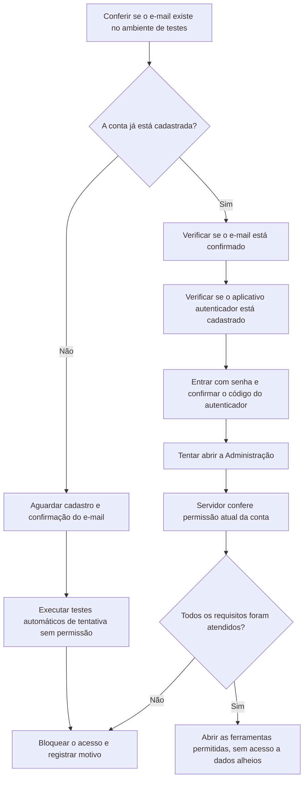

# Farol Finanças | Teste do acesso Super Admin (ambiente Dev)

**Data da execução:** 10/11/2026  
**Conta indicada:** `gubuenoba@gmail.com`  
**Ambiente de teste:** Supabase **Farol Finanças Dev**, referência `tvirkrjkgdtybtcundon`

## Resultado resumido, para quem não trabalha com programação

A conta indicada **ainda não existe no ambiente Dev**, portanto **não foi possível entrar de verdade com ela como Super Admin**. Nenhuma permissão administrativa foi atribuída à conta, e a produção não foi modificada.

Já realizamos a conferência de segurança que antecede esse login:

- A nova rota administrativa exige token válido.
- O usuário precisa confirmar o segundo fator (2FA).
- O servidor verifica o papel atual de Super Admin diretamente no banco, sem confiar apenas no menu.
- A verificação foi reforçada: precisa encontrar **e-mail confirmado** e **autenticador TOTP ainda cadastrado e validado**.
- Um teste com uma identidade sem privilégio no banco Dev retornou **acesso negado**.
- Testes automatizados verificam que remoção do papel tem efeito no próximo acesso, que mensagens de erro não expõem identidades e que falhas no banco não liberam a tela.

**Não é um teste real completo do usuário gubuenoba@gmail.com**; esse cenário permanece pendente até a conclusão do cadastro e do segundo fator no Dev.

## Fluxograma simples de como testamos

## Próximos passos para concluir o teste REAL

1. No **Supabase Dev**, cadastrar ou convidar `gubuenoba@gmail.com` por meio do fluxo oficial de autenticação. O e-mail deve ser confirmado pelo titular.
2. Fazer login **no Dev**, configurar um autenticador TOTP e confirmar que existe um fator **verificado**. Não compartilhar o segredo TOTP nem o código.
3. Por meio de acesso administrativo confiável, atribuir apenas **no Dev** `app_metadata.farol_role = super_admin`, preservando os demais campos de `app_metadata` e registrando a operação.
4. Validar o login real em uma Preview isolada e confirmar a API de backend conectada **apenas ao Dev**. Nunca usar a Preview com URL ou banco de produção.
5. Conferir acesso permitido ao Super Admin e bloqueio com conta comum. Retirar o papel e confirmar que o acesso volta a ser negado.

**O papel não foi atribuído automaticamente:** o sistema não cria privilégios por cadastro público, e-mail informado ou controle do navegador. A API Preview da Vercel ainda precisa de conexão de banco Dev verificada; o limite diário de deployments da Vercel foi atingido em 10/11/2026.

## Evidências

- `backend/tests/superAdminAccess.test.ts`: requisições simuladas à API Fastify.
- `backend/tests/superAdminEligibilityQuery.test.ts`: garantias de e-mail confirmado, 2FA validado e papel de Super Admin atualizado.
- `backend/src/app.ts`: consulta parametrizada do papel no banco.
- Auditoria SQL somente leitura: nenhum usuário correspondente ao e-mail indicado no Dev e nenhum Super Admin já atribuído; verificação de conta fictícia sem privilégio retornou `false`.
- **Nenhuma conta, sessão, autenticador, role ou tabela foi modificada no Supabase Dev/Prod durante esta validação.**
