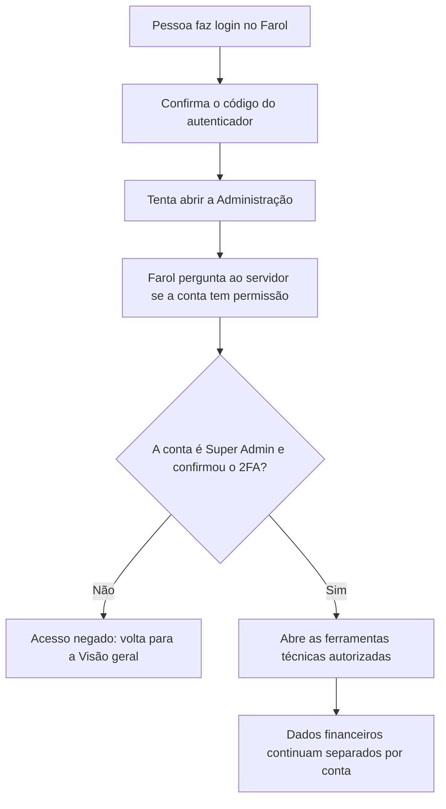
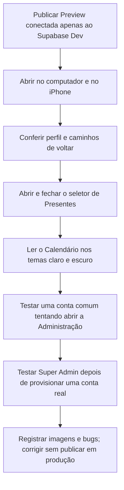

# Farol Finanças | Organização do perfil e ferramentas administrativas

## O que mudou?

O Farol tinha muitas opções misturadas na página Meu perfil. Agora a pessoa encontra ali só o nome, ícone e atalhos para **Segurança e acesso** e **Meus dados na nuvem**. A tela de Segurança reúne o autenticador (2FA) e as opções de celular, mantendo a recuperação por telefone em preparação.

Uma conta com papel especial **Super Admin** encontra a nova área Administração, que reúne atalhos para Backup criptografado, seus próprios dados na nuvem e Segurança da conta. Usuários comuns não veem esses atalhos técnicos.

**O Super Admin não pode acessar automaticamente os dados financeiros particulares de outras pessoas.** Os espaços seguem verificando autorização de cada conta. Ocultar botões não é mecanismo de proteção.

## Como funciona a autorização?

A API valida token assinado, sessão ainda ativa e 2FA. Em seguida consulta o papel atual **diretamente no banco de autenticação**, com query parametrizada e sem mostrar dados pessoais. A consulta retorna somente um sinal de autorizado ou não. Se falhar, o painel não abre.

## Papel de Super Admin: criação da conta

Esta etapa **preparou a estrutura e as proteções**, mas **não criou nem promoveu uma conta de usuário**. Criar uma conta privilegiada exige um e-mail controlado pelo responsável, confirmação e segundo fator. Após essas verificações, o papel `farol_role = super_admin` só deve ser atribuído em `app_metadata` por uma operação administrativa do Supabase, nunca por dados editáveis da pessoa, localStorage, o frontend ou cadastro público.

**Não** usar as duas contas descartáveis de QA como Super Admin. Elas não possuem controle duradouro de caixa de entrada e precisam de exclusão administrativa depois.

O papel antigo `administrador`, que permite Presentes, não ganha automaticamente acesso de Super Admin.

## Navegação e correções

- **Voltar**: nas páginas do aplicativo, volta à tela anterior interna; se o link foi aberto diretamente, encaminha à Visão geral.
- **Visão geral**: botão separado para voltar diretamente ao início.
- **Presentes**: o modal para escolher a pessoa oferece Fechar, clique fora, tecla Esc e a ação clara “Voltar para a visão geral sem escolher”.
- **Calendário**: números dos dias maiores, texto contrastante, fundo bordô/azul acinzentado, e feriados e eventos mais visíveis no tema claro e no escuro.

## Próximos testes

**Importante:** publicação `READY` na Vercel não prova que a Preview usa Supabase Dev. A Vercel ainda possui variáveis de Preview compartilhadas com Production. Antes de fazer login, a Preview precisa ter `VITE_SUPABASE_URL`, `VITE_SUPABASE_PUBLISHABLE_KEY`, `VITE_API_BASE_URL`, `SUPABASE_URL`, `DATABASE_URL` e `CORS_ORIGIN` revisadas e isoladas para a branch. Não testar com dados de produção.

Nenhuma variável secreta, migração de banco ou permissão de produção foi alterada nesta etapa.
